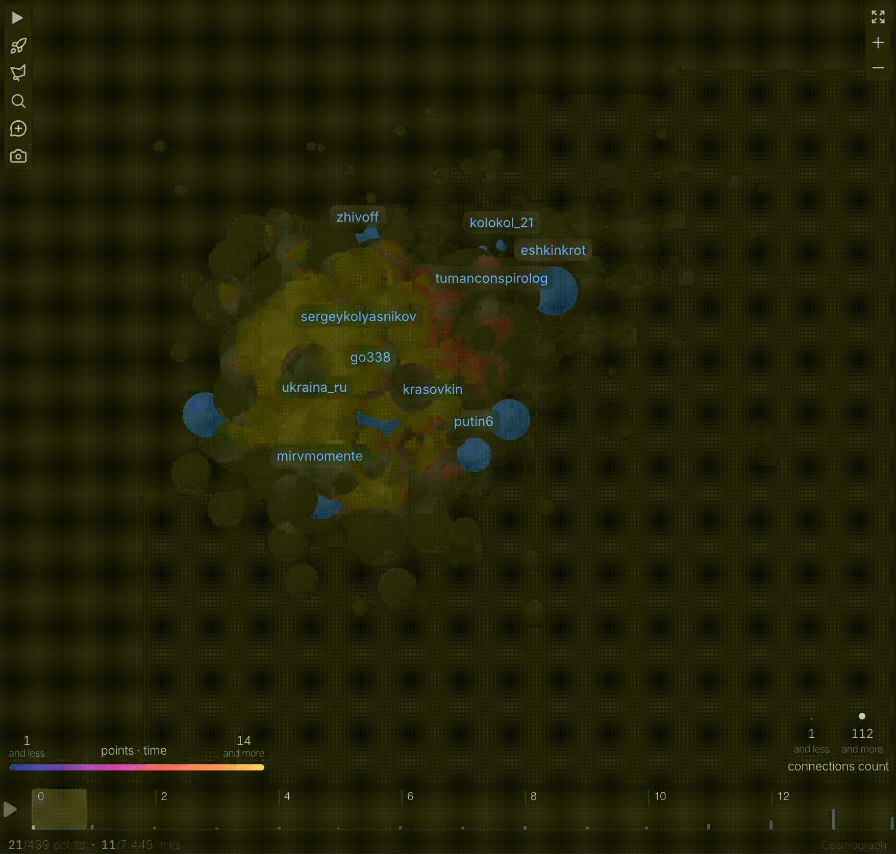
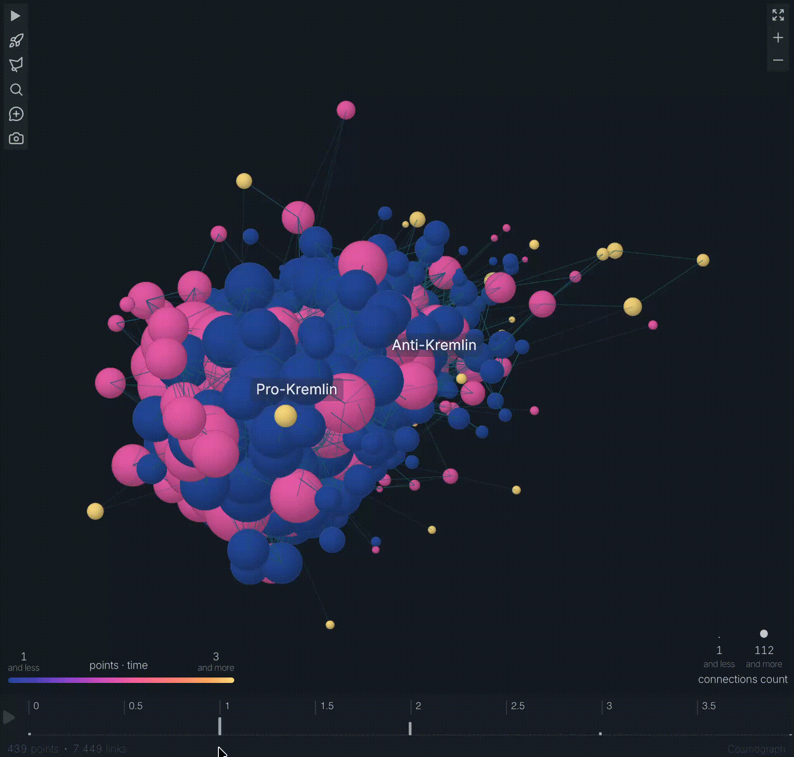

# Assignment 2: Dynamics on Networks — Thresholds and Spreading

## Overview
This project examines how political information spreads across a Telegram network of pro- and anti-Kremlin channels using Granovetter's threshold model of collective behaviour.

The analysis explores how network structure, adoption thresholds, and initial seeding strategies influence information diffusion and the likelihood of large-scale cascades.

## Repository Contents
- `analysis.ipynb` — Jupyter Notebook containing the network analysis, model implementation, simulations, and visualisations.
- `cosmograph_nodes.csv` — Node data.
- `cosmograph_edges.csv` — Edge data.
- `report.pdf` — Final policy report presenting the methodology, results, and policy implications.

## Fun visualisations

### Degree-based seeding (τ = 0.2)

### Random-based seeding (τ = 0.2)

### Betweenness-based seeding (τ = 0.2)

## Data Source
Bawa, A., et al. (2025). *Telegram as a battlefield: Kremlin-related communications during the Russia–Ukraine conflict.* Proceedings of the International AAAI Conference on Web and Social Media, 19(1), 2361–2370.

## Reproducibility
The simulations use fixed random seeds to support reproducibility.
