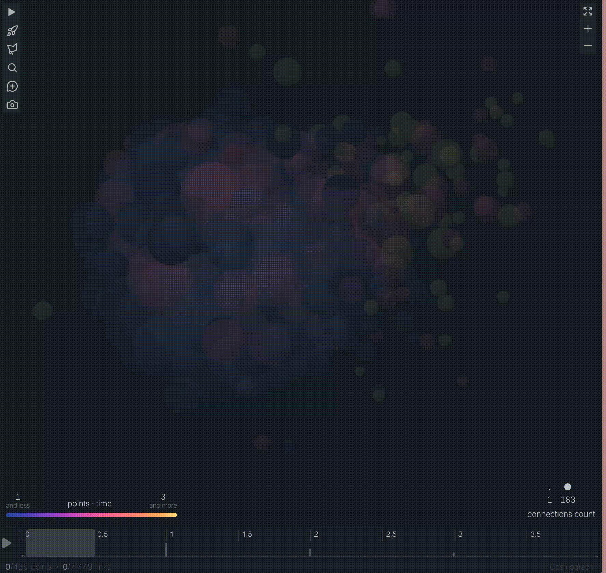

### Degree-based seeding (τ = 0.2)

### How to view the network visualisations

1. Open the corresponding project
* https://run.cosmograph.app/public/050ab60d-524e-4657-9a73-0dd0fcbea81f
*
*
2. In the left-hand panel, select **Snapshots and Stories**.
3. Under **Stories**, select the saved story with the same name as the project.
4. Click **Play** to watch the network diffusion animation.

